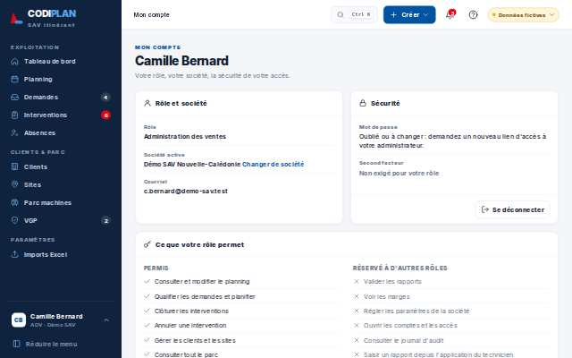
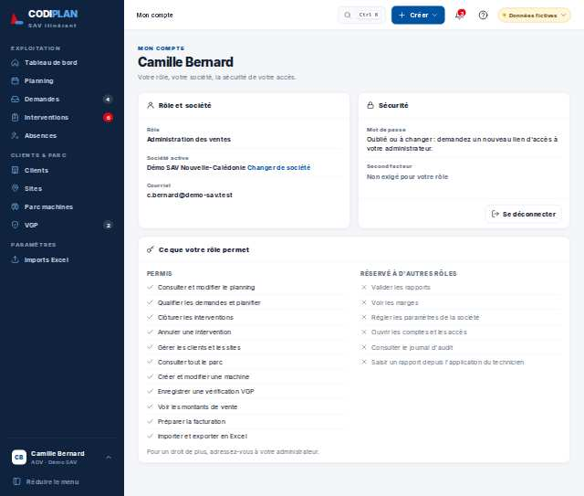
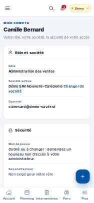
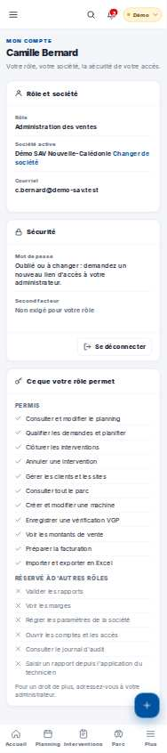

# Paramètres · Mon compte

- **Clé** : `compte`
- **Route réelle** : `absente`
- **Rôle** : admin_societe (bureau, COMPTE_ADMIN_SOCIETE_EPREUVE)
- **Hash de maquette** : `#/compte?role=adv`
- **État** : Aucune route /compte sur le site.
- **Paquet** : P1 — Accès et sans session

## Mesures et verdict automatique

| Largeur | Statut | Verdict | Durée navigation | Anomalies mesurées |
|---|---|---|---|---|
| 1280 px | absente | non mesure | — | aucune |
| 375 px | absente | non mesure | — | aucune |

## Images

### 1280 px

### 375 px

## Écarts avec la maquette

## Ergonomie et textes

## Défauts (cause probable fichier:ligne)

