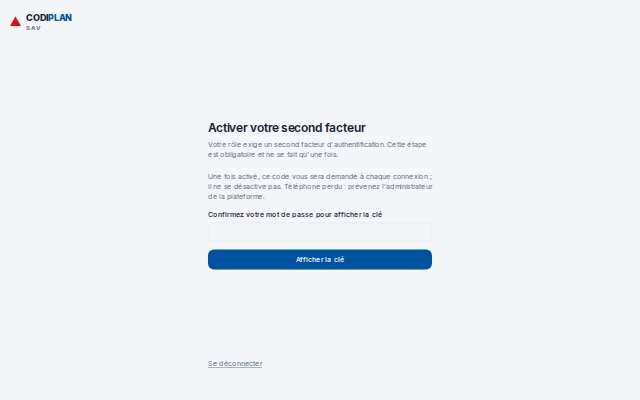
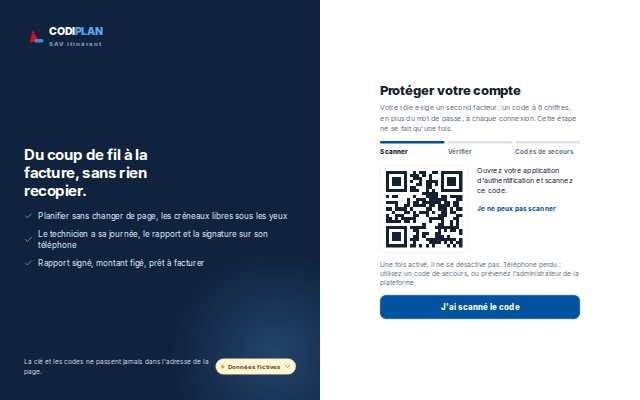

# Accès · Activer le second facteur

- **Clé** : `enrolement`
- **Route réelle** : `/enrolement`
- **Rôle** : spécial, voir note
- **Hash de maquette** : `#/enrolement?role=direction`
- **État** : Compte admin_societe dédié, jamais enrôlé avant cette capture.
- **Paquet** : P1 — Accès et sans session

## Mesures et verdict automatique

| Largeur | Statut | Verdict | Durée navigation | Anomalies mesurées |
|---|---|---|---|---|
| 1280 px | capturee | ecart mesure | — | aucune |
| 375 px | capturee | ecart mesure | — | aucune |

## Images

### 1280 px

### 375 px

## Écarts avec la maquette

## Ergonomie et textes

## Défauts (cause probable fichier:ligne)

