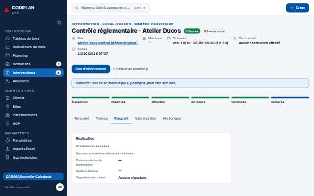
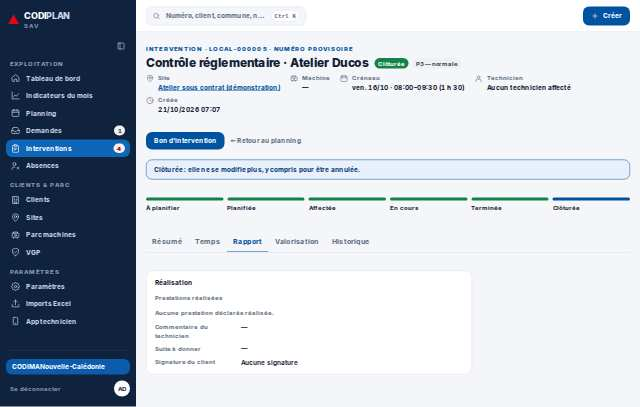
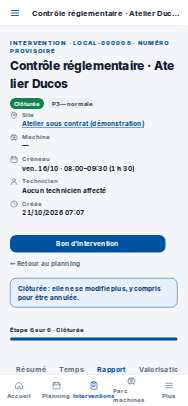

# Exploitation · Fiche intervention — onglet Rapport

- **Clé** : `interventions-onglet-rapport`
- **Route réelle** : `/interventions/0192f0a0-6000-7000-8000-000000000005?onglet=rapport`
- **Rôle** : admin_societe (bureau, COMPTE_ADMIN_SOCIETE_EPREUVE)
- **Hash de maquette** : `aucune`
- **État** : Ajoutée (point 3) : aucun onglet n'était capturé séparément du Résumé.
- **Paquet** : P5 — Fiches intervention et bon

## Mesures et verdict automatique

| Largeur | Statut | Verdict | Durée navigation | Anomalies mesurées |
|---|---|---|---|---|
| 1280 px | capturee | sans maquette | — | aucune |
| 375 px | capturee | ecart mesure | — | aucune |

## Images

### 1280 px

### 375 px

## Écarts avec la maquette

## Ergonomie et textes

## Défauts (cause probable fichier:ligne)

