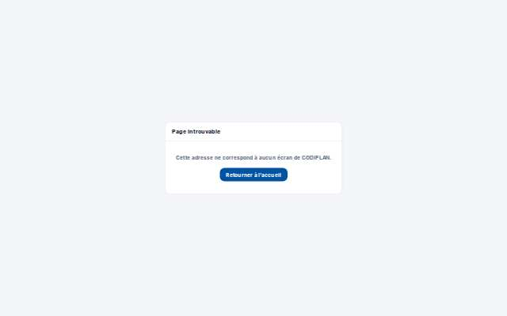

# Paramètres · Calendrier de l'agence

- **Clé** : `parametres-agences-calendrier`
- **Route réelle** : `/parametres/agences/calendrier/01a15990-ac4d-7681-ad82-68d9fc239559`
- **Rôle** : admin_societe (bureau, COMPTE_ADMIN_SOCIETE_EPREUVE)
- **Hash de maquette** : `aucune`
- **État** : Ajoutée (point 2.a) : /parametres/agences/calendrier/[id] existe sur le site, absente du catalogue de la maquette.
- **Paquet** : P7 — Paramètres et imports

## Mesures et verdict automatique

| Largeur | Statut | Verdict | Durée navigation | Anomalies mesurées |
|---|---|---|---|---|
| 1280 px | capturee | ecart mesure | — | 1 réponse(s) 4xx/5xx, 1 erreur(s) console |
| 375 px | capturee | ecart mesure | — | 1 réponse(s) 4xx/5xx, 1 erreur(s) console |

## Images

### 1280 px

### 375 px

## Écarts avec la maquette

## Ergonomie et textes

## Défauts (cause probable fichier:ligne)

