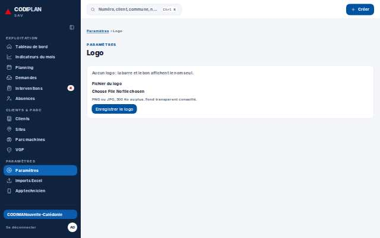
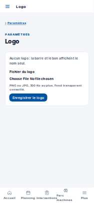

# Paramètres · Société

- **Clé** : `parametres-societe`
- **Route réelle** : `/parametres/societe`
- **Rôle** : admin_societe (bureau, COMPTE_ADMIN_SOCIETE_EPREUVE)
- **Hash de maquette** : `aucune`
- **État** : Ajoutée (point 2.a) : /parametres/societe existe sur le site, absente du catalogue de la maquette.
- **Paquet** : P7 — Paramètres et imports

## Mesures et verdict automatique

| Largeur | Statut | Verdict | Durée navigation | Anomalies mesurées |
|---|---|---|---|---|
| 1280 px | capturee | sans maquette | — | aucune |
| 375 px | capturee | sans maquette | — | aucune |

## Images

### 1280 px

### 375 px

## Écarts avec la maquette

## Ergonomie et textes

## Défauts (cause probable fichier:ligne)

