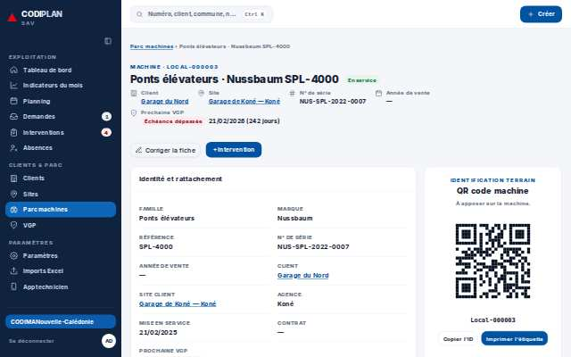
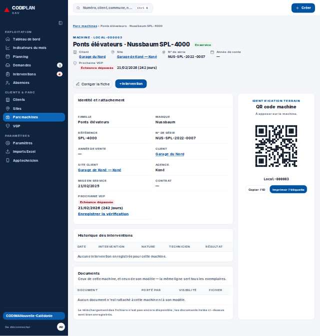
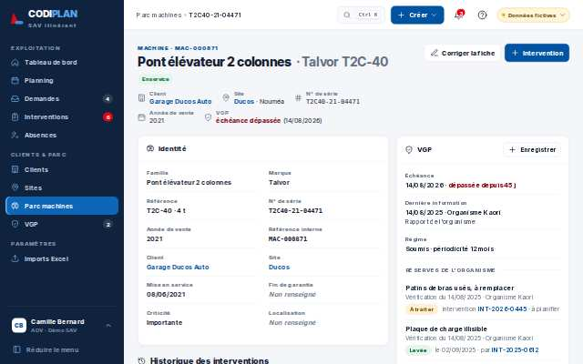
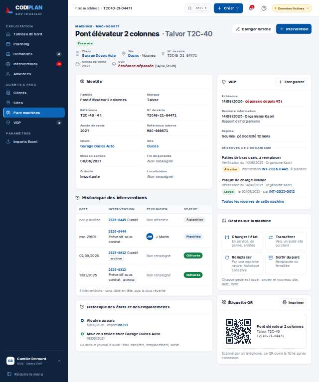
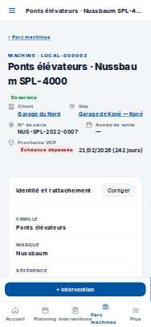
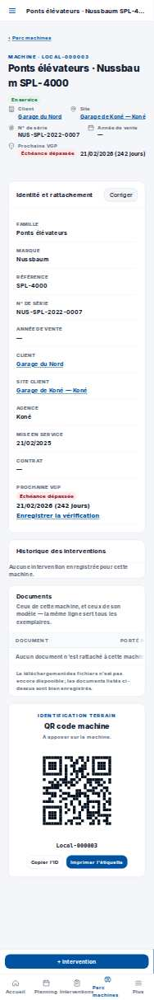
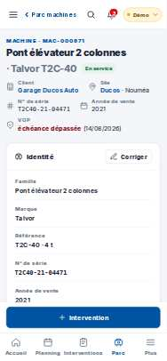
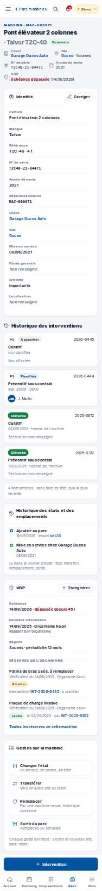

# Clients & parc · Fiche machine

- **Clé** : `parc-m14`
- **Route réelle** : `/parc/0192f0a0-9000-7000-8000-000000000003`
- **Rôle** : admin_societe (bureau, COMPTE_ADMIN_SOCIETE_EPREUVE)
- **Hash de maquette** : `#/parc/m14?role=adv`
- **État** : —
- **Paquet** : P6 — Clients, sites, parc, VGP

## Mesures et verdict automatique

| Largeur | Statut | Verdict | Durée navigation | Anomalies mesurées |
|---|---|---|---|---|
| 1280 px | capturee | ecart mesure | — | aucune |
| 375 px | capturee | ecart mesure | — | aucune |

## Images

### 1280 px

### 375 px

## Écarts avec la maquette

## Ergonomie et textes

## Défauts (cause probable fichier:ligne)

