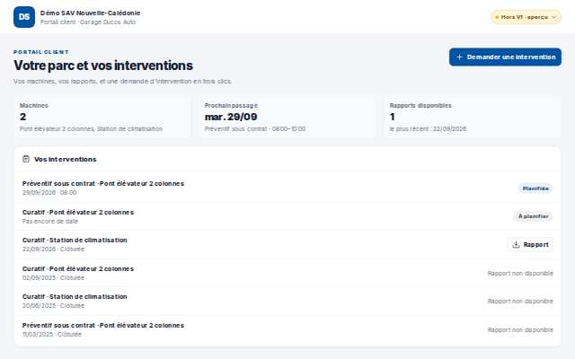
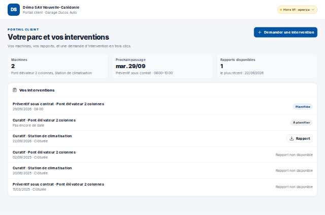
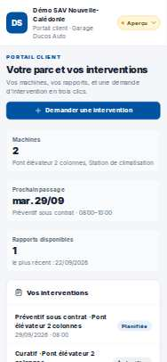
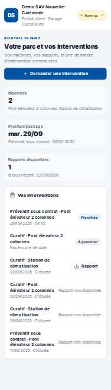

# Hors V1 · Portail client (aperçu)

- **Clé** : `portail`
- **Route réelle** : `/portail`
- **Rôle** : spécial, voir note
- **Hash de maquette** : `#/portail?role=adv`
- **État** : Capture spéciale (point 2.d) : identité séparée (D10), ouverte par sa propre session de démonstration (compte portail@example.test du semis).
- **Paquet** : P1 — Accès et sans session

## Mesures et verdict automatique

| Largeur | Statut | Verdict | Durée navigation | Anomalies mesurées |
|---|---|---|---|---|
| 1280 px | absente | non mesure | — | aucune |
| 375 px | absente | non mesure | — | aucune |

## Images

### 1280 px

### 375 px

## Écarts avec la maquette

## Ergonomie et textes

## Défauts (cause probable fichier:ligne)

