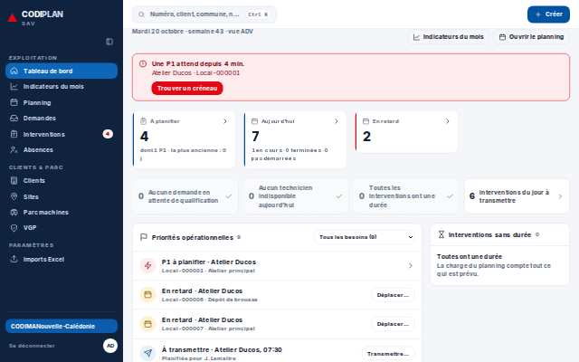
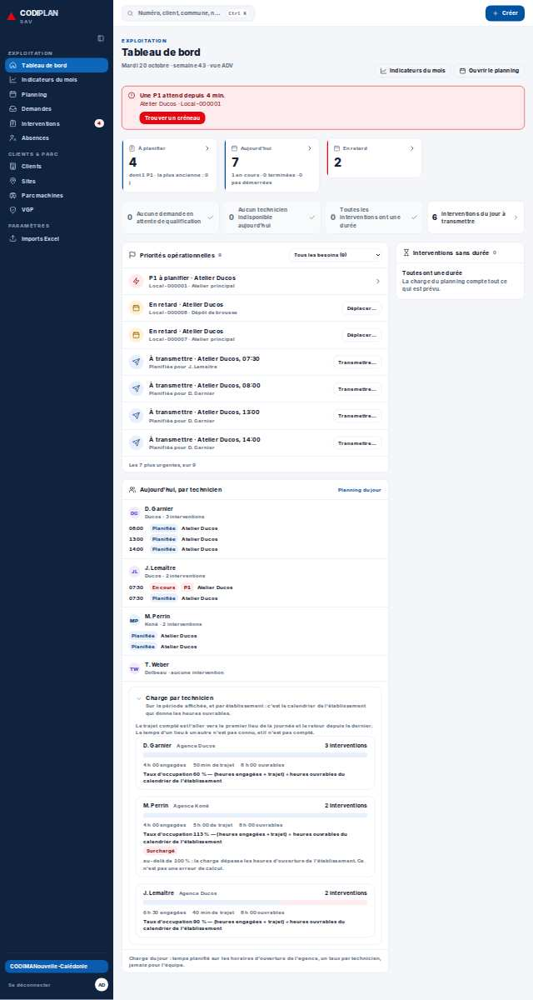
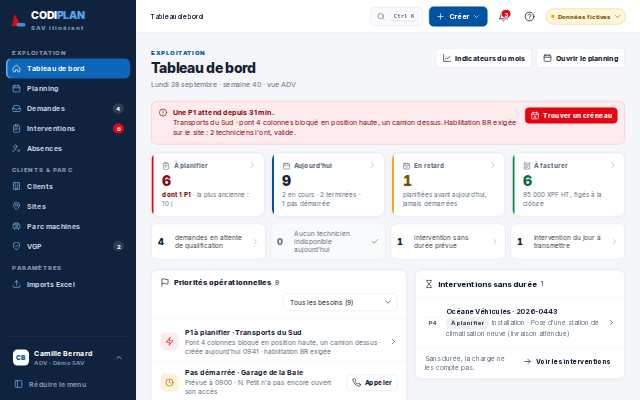
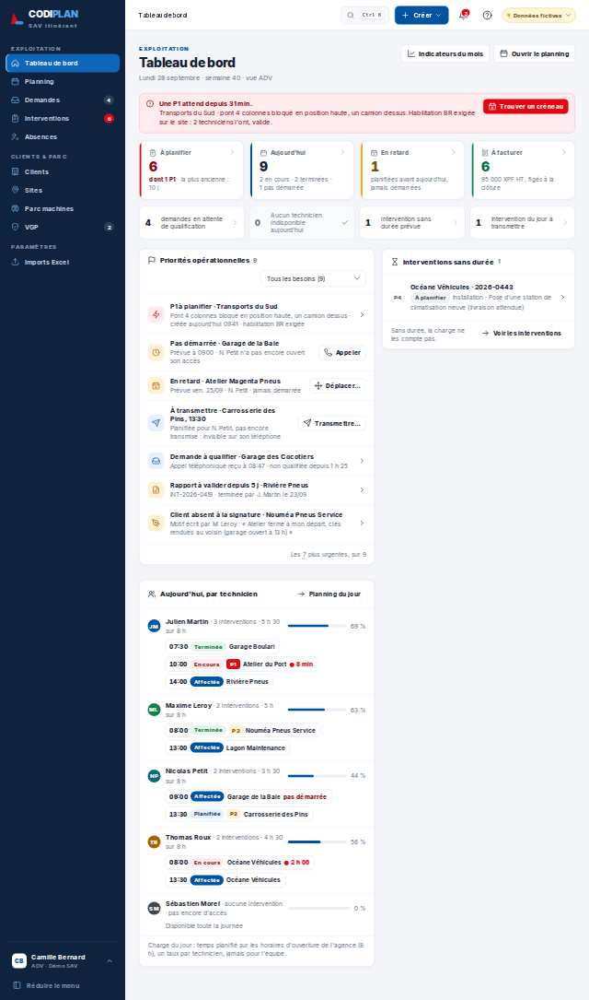
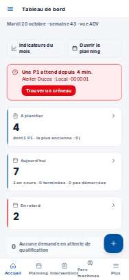
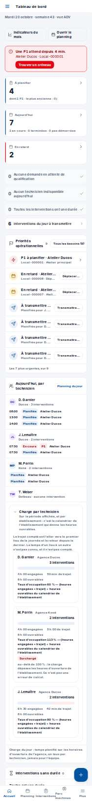
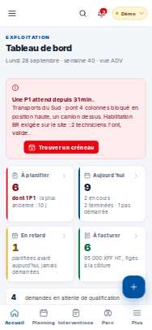
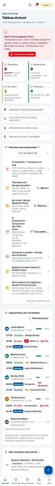

# Exploitation · Tableau de bord — rôle adv

- **Clé** : `tableau-de-bord-adv`
- **Route réelle** : `/tableau-de-bord`
- **Rôle** : adv (adv@codima.test)
- **Hash de maquette** : `#/tableau-de-bord?role=adv`
- **État** : —
- **Paquet** : P2 — Pilotage

## Mesures et verdict automatique

| Largeur | Statut | Verdict | Durée navigation | Anomalies mesurées |
|---|---|---|---|---|
| 1280 px | capturee | ecart mesure | — | aucune |
| 375 px | capturee | ecart mesure | — | aucune |

## Images

### 1280 px

### 375 px

## Écarts avec la maquette

## Ergonomie et textes

## Défauts (cause probable fichier:ligne)

