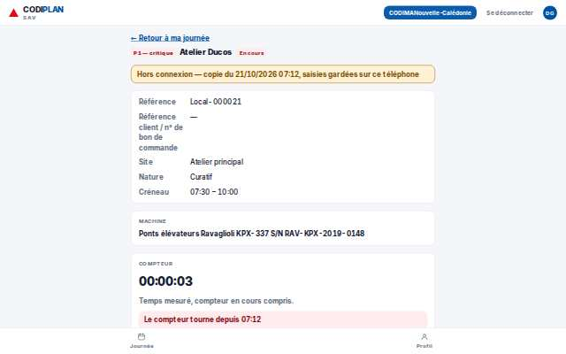
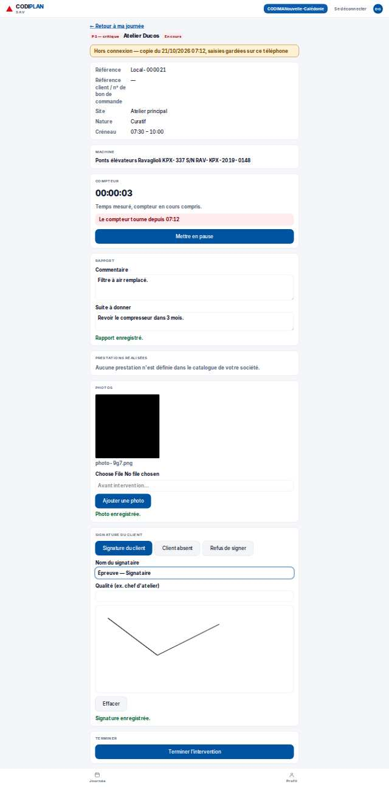
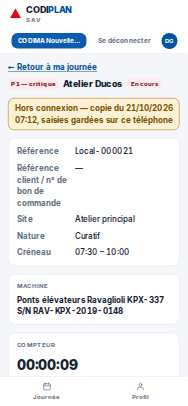

# Terrain · Fiche hors réseau, utilisable (compteur, rapport, prestations, photos, signature, Terminer gardé)

- **Clé** : `terrain-hors-reseau-fiche-utilisable`
- **Route réelle** : `/terrain/0192f0a0-6000-7000-8000-000000000021`
- **Rôle** : technicien (COMPTE_TECHNICIEN_EPREUVE)
- **Hash de maquette** : `aucune`
- **État** : —
- **Paquet** : P8 — Terrain

## Mesures et verdict automatique

| Largeur | Statut | Verdict | Durée navigation | Anomalies mesurées |
|---|---|---|---|---|
| 1280 px | capturee | ecart mesure | — | 2 champ(s) sans étiquette |
| 375 px | capturee | ecart mesure | — | 2 champ(s) sans étiquette |

## Images

### 1280 px

### 375 px

## Écarts avec la maquette

## Ergonomie et textes

## Défauts (cause probable fichier:ligne)

