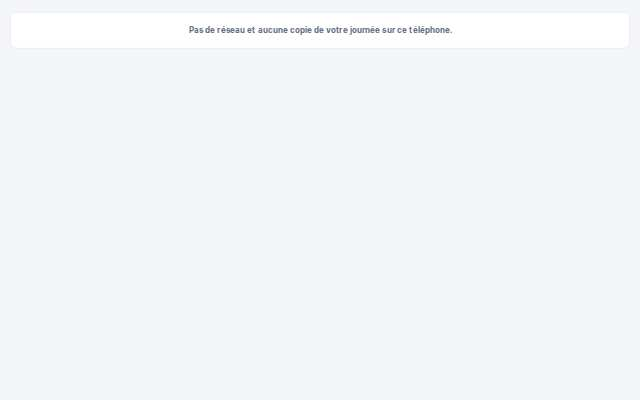
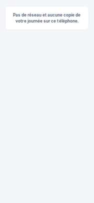

# Terrain · Coquille hors réseau

- **Clé** : `terrain-hors-reseau`
- **Route réelle** : `/terrain-hors-reseau`
- **Rôle** : anonyme
- **Hash de maquette** : `aucune`
- **État** : Ajoutée (point 2.a et 2.c) : coquille affichée hors réseau, absente du catalogue de la maquette.
- **Paquet** : P8 — Terrain

## Mesures et verdict automatique

| Largeur | Statut | Verdict | Durée navigation | Anomalies mesurées |
|---|---|---|---|---|
| 1280 px | capturee | sans maquette | — | aucune |
| 375 px | capturee | sans maquette | — | aucune |

## Images

### 1280 px

### 375 px

## Écarts avec la maquette

## Ergonomie et textes

## Défauts (cause probable fichier:ligne)

