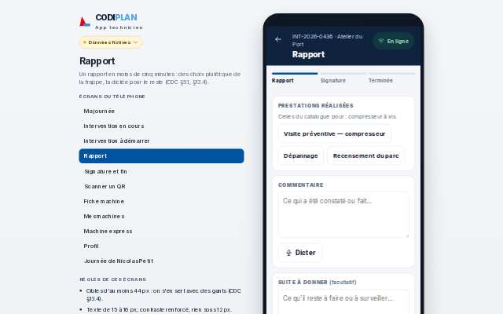
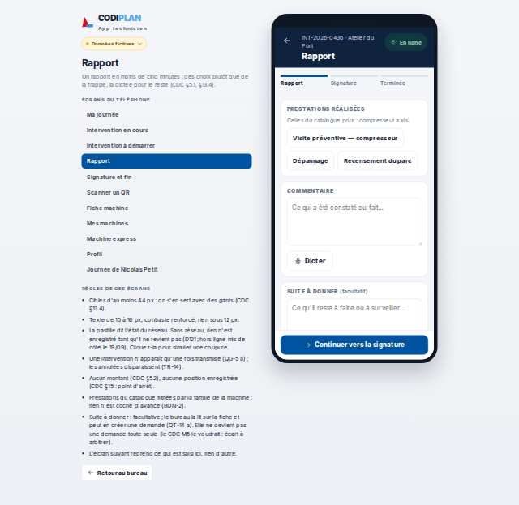
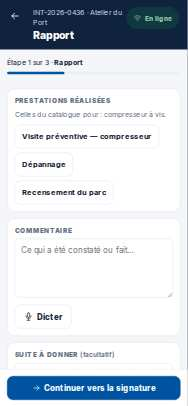
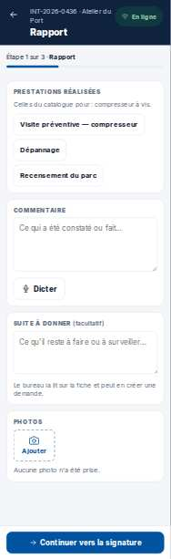

# Terrain · Rapport

- **Clé** : `terrain-i-i436-rapport`
- **Route réelle** : `absente`
- **Rôle** : technicien (COMPTE_TECHNICIEN_EPREUVE)
- **Hash de maquette** : `#/terrain/i/i436/rapport?role=technicien`
- **État** : Pas de route dédiée : `/terrain/[id]` est une page unique, le rapport s'atteint par une action dans l'écran, non par une URL directe — non couvert dans le temps imparti.
- **Paquet** : P8 — Terrain

## Mesures et verdict automatique

| Largeur | Statut | Verdict | Durée navigation | Anomalies mesurées |
|---|---|---|---|---|
| 1280 px | absente | non mesure | — | aucune |
| 375 px | absente | non mesure | — | aucune |

## Images

### 1280 px

### 375 px

## Écarts avec la maquette

## Ergonomie et textes

## Défauts (cause probable fichier:ligne)

