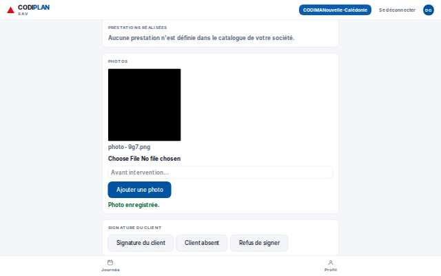
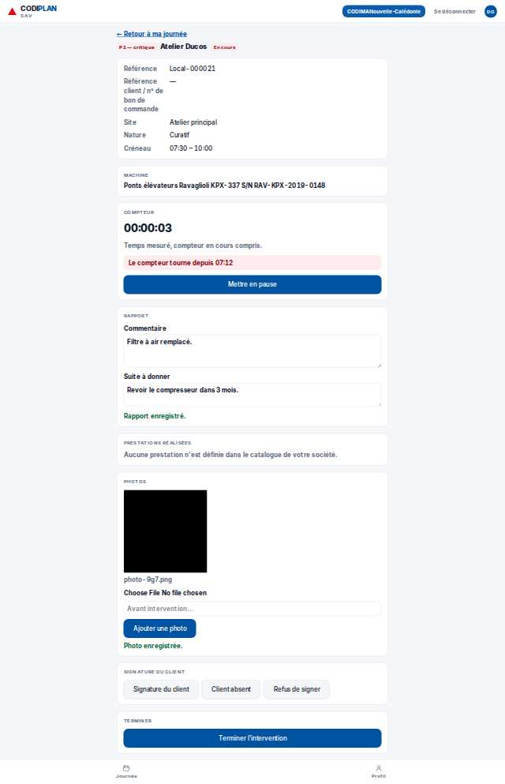
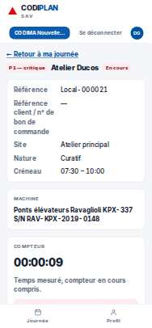
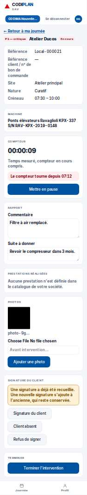

# Terrain · Rapport

- **Clé** : `terrain-i-i436-rapport`
- **Route réelle** : `absente`
- **Rôle** : technicien (COMPTE_TECHNICIEN_EPREUVE)
- **Hash de maquette** : `#/terrain/i/i436/rapport?role=technicien`
- **État** : Pas de route dédiée : /terrain/[id] est une page unique, le rapport s'atteint par une action dans l'écran, non par une URL directe. Capturé par le bloc « Terrain · intervention pilotée » (point 2 du ticket 9G7-AUDIT-COMPLEMENT), qui réécrit cette clé après avoir rempli le rapport.
- **Paquet** : P8 — Terrain

## Mesures et verdict automatique

| Largeur | Statut | Verdict | Durée navigation | Anomalies mesurées |
|---|---|---|---|---|
| 1280 px | capturee | ecart mesure | — | 2 champ(s) sans étiquette |
| 375 px | capturee | ecart mesure | — | 2 champ(s) sans étiquette |

## Images

### 1280 px

### 375 px

## Écarts avec la maquette

## Ergonomie et textes

## Défauts (cause probable fichier:ligne)

