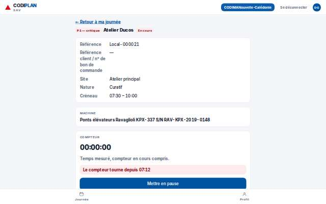
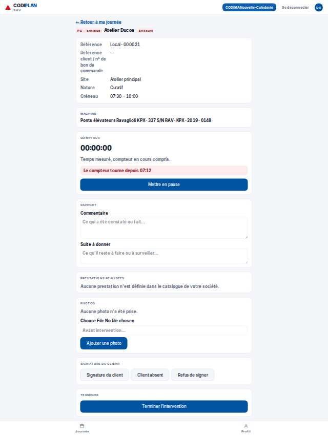
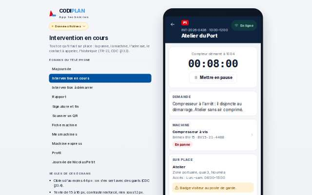
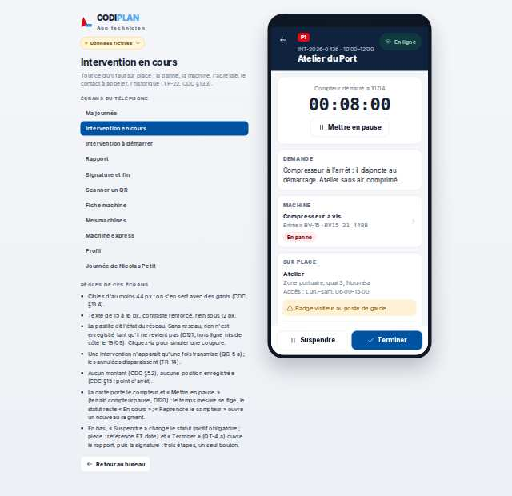
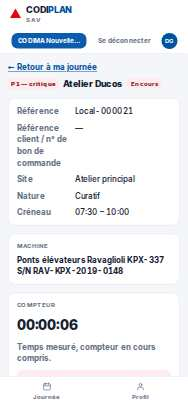
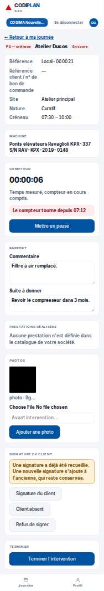
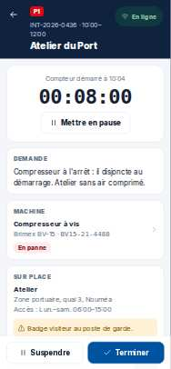
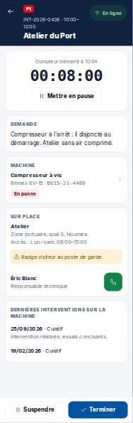

# Terrain · Intervention en cours

- **Clé** : `terrain-i-i436`
- **Route réelle** : `absente`
- **Rôle** : technicien (COMPTE_TECHNICIEN_EPREUVE)
- **Hash de maquette** : `#/terrain/i/i436?role=technicien`
- **État** : Repère partagé avec la fiche back-office « en cours » : même intervention, deux écrans.
- **Paquet** : P8 — Terrain

## Mesures et verdict automatique

| Largeur | Statut | Verdict | Durée navigation | Anomalies mesurées |
|---|---|---|---|---|
| 1280 px | capturee | ecart mesure | — | 2 champ(s) sans étiquette |
| 375 px | capturee | ecart mesure | — | 2 champ(s) sans étiquette |

## Images

### 1280 px

### 375 px

## Écarts avec la maquette

## Ergonomie et textes

## Défauts (cause probable fichier:ligne)

